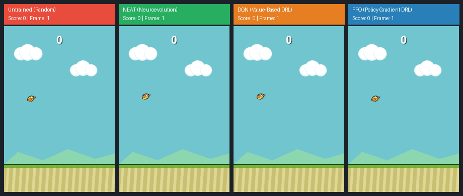
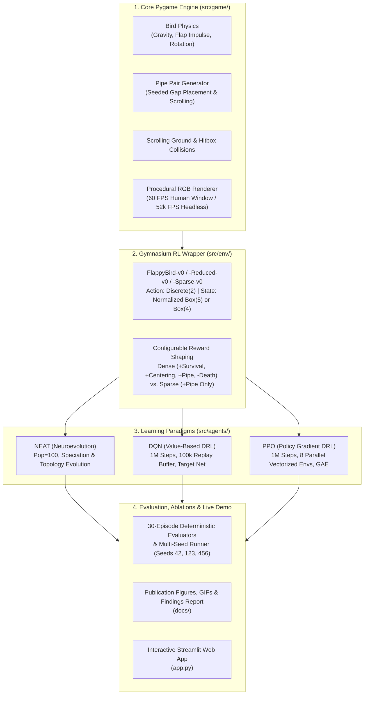
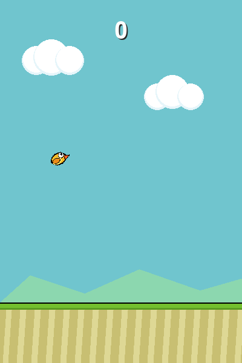
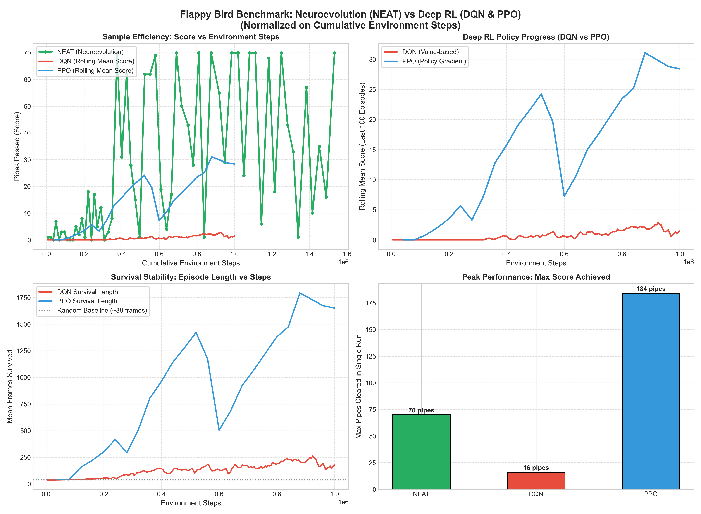
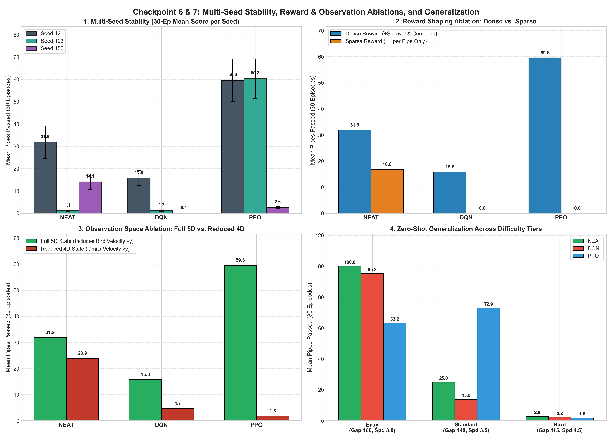

# flappygym: A custom Flappy Bird Gymnasium environment with NEAT, DQN and PPO agents, multi-seed evaluation, ablation studies and a Streamlit demo.



---

## 🚀 Run in 3 Commands (Quick Start for Any Visitor)

```bash
# 1. Install dependencies
pip install -r requirements.txt

# 2. Launch the Interactive Live Web Demo (Browser Dashboard)
streamlit run app.py

# 3. Play by hand in Pygame OR run the 31-test automated verification suite
python3 play.py
pytest tests/ -v
```

---

## 🏗️ System Architecture



---

## 🎞️ Demo GIFs: Untrained vs. Trained Agents

| Untrained Random Baseline | NEAT (Neuroevolution) | DQN (Value-Based DRL) | PPO (Policy Gradient DRL) |
| :---: | :---: | :---: | :---: |
|  |  |  |  |
| **0.00 ± 0.00 pipes** (~38 frames) | **31.87 ± 28.93 pipes** (Max: **100**) | **15.80 ± 13.12 pipes** (Max: **47**) | **59.57 ± 38.39 pipes** (Max: **100**) |

---

## 📊 Main Benchmark Results (Checkpoints 3–5)

> All agents aligned on **cumulative environment steps** (~1.0M–1.5M steps) and evaluated over **30 deterministic episodes** (`max_pipes=100` cap per evaluation episode).



| Algorithm | Paradigm | Total Env Steps | Train Peak | Eval Mean ± Std (30 Eps) | Eval Max | Wall-Clock Train Time |
| :--- | :--- | :---: | :---: | :---: | :---: | :---: |
| **PPO** (`n_envs=8`) | On-Policy Policy Gradient | 1,015,808 | **184** | **59.57 ± 38.39** | **100** | ~3.8 min (230s) |
| **NEAT** (`pop=100`) | Neuroevolution | 1,533,253 | 70 | **31.87 ± 28.93** | **100** | **~20.5 sec** |
| **DQN** (`buf=100k`) | Off-Policy Value-Based DRL | 1,000,000 | 16 | **15.80 ± 13.12** | 47 | ~5.0 min (298s) |
| **Random Agent** | Uniform Random Baseline | 5,000 | 0 | **0.00 ± 0.00** | 0 | <0.1 sec |

---

## 🔬 Checkpoint 6 — Multi-Seed Stability & Controlled Ablations



### 1. Multi-Seed Stability (Seeds `42`, `123`, `456` — 30 Episodes per Seed)

| Algorithm | Seed 42 Avg | Seed 123 Avg | Seed 456 Avg | Across-Seed Mean ± Std | Peak Max |
| :--- | :---: | :---: | :---: | :---: | :---: |
| **PPO** | 59.57 | **60.33** | 2.60 | **40.83 ± 27.04** | **100** |
| **NEAT** | 31.87 | 1.13 | 14.07 | **15.69 ± 12.60** | **100** |
| **DQN** | 15.80 | 1.17 | 0.07 | **5.68 ± 7.17** | **47** |

### 2. Reward-Shaping & Observation-Space Ablations (30-Episode Deterministic Eval)

| Algorithm | Baseline (Full 5D + Dense) | Sparse Reward Only (+1/pipe) | Reduced 4D State (No Velocity $v_y$) |
| :--- | :---: | :---: | :---: |
| **PPO** | **59.57** (max 100) | **0.00** (max 0) | **1.83** (max 6) |
| **NEAT** | **31.87** (max 100) | **16.80** (max 64) | **23.93** (max 100) |
| **DQN** | **15.80** (max 47) | **0.00** (max 0) | **4.70** (max 17) |

### 3. Zero-Shot Difficulty Generalization (30-Episode Deterministic Eval)

| Difficulty Tier | NEAT (Mean / Max) | DQN (Mean / Max) | PPO (Mean / Max) |
| :--- | :---: | :---: | :---: |
| **Easy (`Gap=160, Speed=3.0`)** | **100.00 / 100** | **95.27 / 100** | 63.23 / 100 |
| **Standard (`Gap=140, Speed=3.5`)** | 25.00 / 100 | 13.87 / 47 | **72.90 / 100** |
| **Hard (`Gap=115, Speed=4.5`)** | **2.80 / 9** | 2.23 / 8 | 1.80 / 7 |

---

## 📝 Checkpoint 7 — Key Findings: Which Method Won and Why?

Full analysis and failure-case breakdown: **[docs/findings_report.md](docs/findings_report.md)**

1. **PPO won on overall policy performance and reliability (`59.57 ± 38.39` pipes, `100` eval max, `184` train max, `40.83` multi-seed mean)** because parallelizing rollouts across **8 vectorized environments** stabilizes on-policy GAE advantage estimates when paired with dense survival + gap-centering rewards and a full 5D Markovian state.
2. **NEAT won on wall-clock speed (`20.5s` vs. `4–5 min`) and ablation resilience (`31.87 ± 28.93` pipes, `100` max)**. Because NEAT selects over episodic population fitness rather than step-by-step TD bootstrapping, it was the **only method to survive sparse rewards (`16.80` avg, `64` max vs. `0.00` for PPO/DQN)** and suffered the smallest drop when vertical velocity $v_y$ was removed (`23.93` avg vs. `1.83` for PPO).
3. **Why failures occurred:** Under **sparse rewards**, untrained birds crash in ~38 frames before reaching the first pipe (~95 frames away), producing zero return ($G_t = 0$) and zero gradient for DQN/PPO. Under **reduced 4D state (no $v_y$)**, rising and falling trajectories at the same height $y$ are aliased, breaking the Markov property and corrupting TD value estimation.

---

## 🛠️ Complete CLI Reference

### Play by Hand (Checkpoint 1)
```bash
python3 play.py --gap-size 140 --speed 3.5 --debug
```
- `SPACE` / `UP` / Left-Click: Flap | `D`: Toggle debug hitboxes | `R`: Restart | `ESC`: Quit

### Validate Gymnasium Environment (Checkpoint 2)
```bash
python3 verify_checkpoint2.py --steps 5000
```

### Watch Trained Agents Play Live in a Pygame Window (Checkpoints 3–5)
```bash
python3 src/agents/neat/evaluate_neat.py --episodes 5 --render
python3 src/agents/dqn/evaluate_dqn.py --episodes 5 --render
python3 src/agents/ppo/evaluate_ppo.py --episodes 5 --render
```

### Train Agents from Scratch
```bash
# NEAT (~20 sec)
python3 src/agents/neat/train_neat.py --generations 60 --target 50 --seed 42

# DQN (~5 min, 1M steps)
python3 src/agents/dqn/train_dqn.py --timesteps 1000000 --seed 42

# PPO (~4 min, 1M steps, 8 parallel envs)
python3 src/agents/ppo/train_ppo.py --timesteps 1000000 --seed 42
```

### Regenerate Plots, Ablations & Comparison GIFs (Checkpoints 6–8)
```bash
python3 src/experiments/compare_learning_curves.py
python3 src/experiments/plot_ablations.py
python3 src/experiments/generate_comparison_gif.py
```

---

## 📁 Repository Structure

```
Flappy bird RS/
├── app.py                              # Interactive Streamlit Live Web Demo
├── play.py                             # Human-playable Pygame launcher
├── verify_checkpoint2.py               # Gymnasium check_env + 5k-step random agent benchmark
├── pytest.ini                          # Pytest configuration
├── requirements.txt                    # Locked project dependencies
├── config/
│   ├── neat_config.txt                 # NEAT hyperparameters (5D state)
│   └── neat_config_4d.txt              # NEAT ablation config (4D reduced state)
├── src/
│   ├── game/                           # Core Pygame simulation engine (bird, pipes, ground, renderer)
│   ├── env/                            # Gymnasium environment wrapper (FlappyBird-v0)
│   ├── agents/                         # NEAT, DQN, PPO training/evaluation & SB3 callbacks
│   └── experiments/                    # Learning curves, multi-seed/ablation runner, GIF generator
├── models/                             # Saved best checkpoints (.pkl, .zip) & ablation models
├── logs/                               # Training/eval JSON logs & TensorBoard event files
├── docs/                               # Plots, demo GIFs, findings_report.md, resume_bullets.md
└── tests/                              # 31 automated unit & integration tests
```
